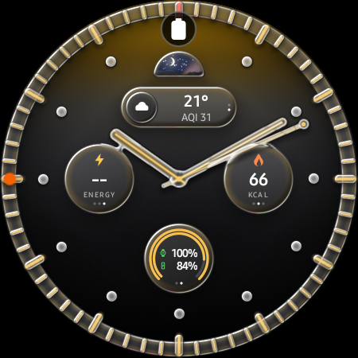
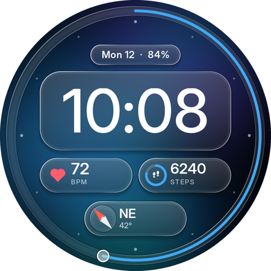
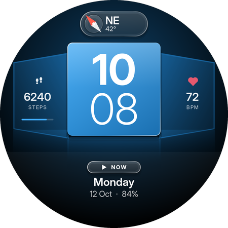
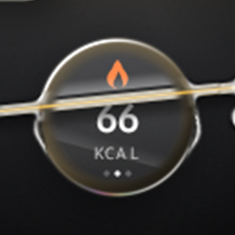

# LiquiWatch

Watch faces in liquid glass for Galaxy Watch, and their companion app.

  
  
  

Expedition, on a Galaxy Watch4 Classic on its charger (the icon at 12 o'clock and the dot at 9 are the watch's own); Liquid and Covers, as their previews show them

| Module | What it is |
|---|---|
| `watchfaces/` | The three faces, in Google's Watch Face Format (XML only, no code). One build variant per face. |
| `wear/` | The faces' companion, watch half: the compass, and the Expedition face's panel pages (and the song on its date pill, with its cover, as Cover Display tells it). |
| `phone/` | The faces' companion, phone half: reads Samsung Health, fetches the weather and reads the phone's battery for the panels when the watch asks, and sends them to the watch. |
| `shared/` | What the companion's two halves say to each other. |
| `tools/trace/` | A recorder for a system trace of the watch, run from Windows (see *Recording a system trace*). |
| `tools/jelly/` | What makes the Expedition face's jelly glass: its bulge pictures and the bulges in its XML (see *Jelly glass* under *How the melting works*). |
| `tools/ring/` | What makes the Expedition face over from the face as it was (`expedition_source.xml`): its minute ring, Cover Display's glass on the ring and the panels, and the hands' risen glass, shadows and waves (see *The minute ring and its glass*). |

LiquiWatch is separate from **Cover Display**, the music app. The two share no code, and the companion has its own app ID (`com.liquiwatch.companion`). The faces only lean on Cover Display for the playing song's blurred cover, its colour and its progress, through complications it provides, and the companion for the song's name and artist on the date pill, which Cover Display tells it. Without Cover Display installed, the faces just keep their own backdrop and colours, show no progress line, and the pill never shows a song.

`liquiwatch_expedition_demo.mp4` (sent with this project) shows the Expedition face's features in about a minute. It's rendered frame by frame from the face's XML with the companion apps' data simulated, not filmed on a watch.

## The faces

Each one shows your heart rate, your steps toward your daily goal, the date, the battery and a compass:

- **Expedition** (`expedition`): an analog face in liquid glass.
  - **Minute ring:** a thin glass tube round the edge, Cover Display's progress tube: milky and frosted, its rim lit from the top left, smoked in the panels' shade of the accent. A small glass knob stands across it at each minute and a bigger one at each hour, reaching in past its inner wall, each holding a line of the accent (12 o'clock's red). The compass card that was round the edge is gone; the heading is on the 6 o'clock dial's compass page (see *The compass*).
  - **Song progress:** while a song plays, a line in the album's colour runs along the middle of the ring's tube from 12 o'clock to where the song is, softened under the tube's frosted glass and bleeding its colour into it, with a clear glass knob at its end (Cover Display's slider knob, lit as it faces wherever it is), in which the line shows crisp. The line and the knob glide on with the song over each second; on a song switch, a seek or a resume they jump to the new place rather than sweeping round the ring. The hands' lines take the colour too. A second and a half after the music pauses, the line, its knob and the colour go (a skip doesn't blink them: Cover Display tells a skip from a pause).
  - **Hands:** glass tubes, milky and deepened as the ring's glass is, each holding a thin line of colour that bleeds a little into its glass (the second hand's less, its glass being thin). They stand up off the face: each casts a soft shadow, on the face and on the panels, and passes over the panels on top of them, the panel's glass rising under it to meet it (see *Melting*). At their full width they flow into a small glass hub at the centre (the size the cap was) through liquid glass necks, so their glass no longer piles up there; their coloured lines still cross under the hub. The seconds hand's counterweight flows out of the hub's other side. The seconds hand ticks once a second, like a quartz watch's, six degrees at a time, landing exactly on each second (it beat eight times a second, like a mechanical watch's, until the face was made quartz: see *Quartz* under *How the melting works*). The watch draws a hand upright and then turns the picture, and a bright edge or a line with hard edges comes out stair-stepped at most angles, so on the hands the glass's bright edge and dark outline are about a pixel wide and soft (on the panels, which stand still, they stay crisp), and each coloured line has a soft edge under it: the hands stay smooth at any angle and don't shimmer as they move.
  - **Smoked glass:** the hands' glass is smoked in a deep, rich shade of the accent, and the minute ring's tube and its knobs in the panels' shade. The panels' glass (the three dials, the date pill and the day and night window) is smoked more quietly, in a darker, muted shade of the accent (the album's colour while a song plays, as the hands' is; its saturation the accent's own), only in a narrow band round each panel's edge, easing to clear glass a little way in, under the glass and what's in it, so readings stay bright. The hands' glass is clear down the middle of each tube, where its line of colour runs, and deepening toward its walls, fading to clear toward the centre: full smoke over the outer part of the hands (from about 60% of the way along the hour hand), easing off to clear glass at the hub. The hour and minute hands are smoked as one body of glass: never darker where they cross, and when they melt into each other the glass between them is smoked too, as far as their glass is joined and no further. The seconds hand's smoke is its own, the same to look at; where its glass melts into the hour or minute hand's, the glass is smoked once over, not twice. Over a panel a hand's glass and smoke carry on, on top of the panel, from a little inside its edge, where the hand's necks into the panel's rim end. The lines and markings stay bright on top.
  - **Hands melting into each other:** when two hands come close, their glass melts into one piece with a neck between them, all the way into the hub, and pulls apart again as they part. Further apart, they still melt together near the hub, where their necks meet, until they're about 60° apart. One pair melts at a time: the minute and hour hands first (they stay close for minutes), then the seconds hand with the minute hand, then with the hour hand.
  - **Melting:** the hands melt into the glass they cross. As a hand nears a dial, the date pill or the day and night window, a neck of glass pulls out between them. Where it crosses, the hand's glass melts into the panel's rim through smooth necks at its edges and carries on over the panel on top of it, and the panel's glass rises to meet it there: a soft swell along the hand and round its tip, lighter where it faces the top left and darker where it faces away. A hand leaving draws a short strand of glass out of the panel, thinning as the hand moves away until it breaks.
  - **The glass keeps its size:** only the necks and strands change shape. The seconds hand's glass bead melts into each hour marker it passes and draws a short strand out of it as it leaves; the marker keeps its size. Only the bead at the hand's end takes part: the hand's shaft keeps its clear glass all the way past the marker.
  - **Jelly glass:** the panels' glass gives like a thick liquid in a flexible skin. At each tick while the seconds hand crosses a dial, the date pill or the day and night window, a bulge of the glass's own rim runs from where the hand crosses it on towards where the hand will leave, over two seconds, sinking back into the rim and fading before it gets there: as if each tick pushed the glass on. A tick after the hand has left a dial, two bulges run back round from where it left to where it came in, one each way, fading as they meet, like water that has hit the far side of its glass and comes back. The bulges are the rim itself risen on soft shoulders, as the hand necks pull the glass, and the glass doesn't otherwise change shape. A tap on a panel sends two from its top and two from its bottom, meeting and fading at its sides, in a second. And at each tick the glass the hand pushed runs on ahead of it: a ridge of risen glass, as high as the one under the hand, across the panel from edge to edge, sinking as it goes until it's gone, within the second.
  - **Day and night window:** above the date, a wheel turns once a day. The sun climbs through the morning sky behind a mountain ridge, stands at the top at noon and sets at dusk, then the moon and stars come round for the night.
  - **Panels:** tap one to flip it to its next reading (see *The panels* below). The date pill's first page shows tonight's moon: the whole face of the moon, its lit part bright and the rest dimly lit by earthshine, so a thin crescent or a new moon still shows (it used to be a dark disc then). The pill is a little bigger than it was, with the moon in a window 36 pixels across (it was 28), drawn at the screen's own resolution with its seas, small craters and the bright young craters, and a crisp line between day and night: it was a picture three times the size, which the watch shrank by taking one pixel in every three, so it looked rough and blurred. (Each day's moon now takes 6 KB of the watch's picture memory rather than 32.)
  - **Hour markers:** glass beads between the ring and the panels, milky and lit from the top left as the panels are, on a small shadow.
  - **Backdrop:** Gold to start with: a gold glow at the top, under the minute ring, fading through grey to black at the bottom. Ocean, Ember, Violet, Forest and Black are the others (see *Customize*).
  - **Glass:** every piece bends the backdrop behind it. Its rim pulls in what lies beyond its edge, and its body magnifies a little. Over the album art (a soft blur, where bending shows next to nothing) the panels are plain glass. The ring, its knobs and the panels are in Cover Display's glass, deeper: a light milky frost, a gradient through the body, a soft glow and a hair-thin highlight round the rim (brightest top left and bottom right), the rim shaded where it turns away, an inner shadow along its dark side, a faint dark outline, a touch of rainbow along the bottom edges, and a soft shadow that lifts it off the face.
  - **It follows Cover Display:** while a song plays, the background becomes that song's cover, blurred. A second and a half after the music pauses or stops, the face goes back to its own backdrop. Where to tap for what is under *Where to tap* below.
- **Liquid** (`liquid`): a digital face with a glass time card and a seconds ring.
- **Covers** (`coverflow`): the time as a cover in the middle of a Cover Flow, with steps and heart rate on the side covers.

Expedition's seconds hand passing over the 3 o'clock dial, on top of it (three times the size): its glass melts into the dial's rim at both edges, and the dial's glass rises along it.

### The panels

Each of the Expedition face's four glass panels shows one reading at a time. Tap a panel and the next reading slides in from the right (in about a third of a second), with a tick on your wrist; small dots show which page is up.

Watch faces can't take swipes: the watch keeps swipes for tiles, notifications and the quick panel. They can't remember anything either. So the companion's watch half keeps count: each panel's slot holds its page complication, a tap on the panel goes to the companion, and the companion moves the page on.

| Panel | Pages, in order | Where they come from |
|---|---|---|
| 9 o'clock dial | heart rate · sleep score · Energy score | the watch · Samsung Health · Samsung Health |
| 3 o'clock dial | steps toward your goal · active calories · blood oxygen (SpO2) | the watch · Samsung Health · Samsung Health |
| 6 o'clock dial | compass heading · battery, the watch's and the phone's | the companion's compass · the watch and the companion's phone half |
| Date pill | date, moon and battery · weather now (while a song plays: the song) | the watch · the companion's phone half (see *The weather*), or the watch's own weather · Cover Display |

- **The weather page:** the temperature now on top, India's air quality index under it (`AQI 78`), and the sky in the moon's window (sun or moon, cloud, rain and so on, by day or by night), as the companion's phone half last fetched them. With none from it for 3 hours, the page shows the watch's own temperature, if the watch has one (`--°` and *No weather* if not), under an unknown sky.
- **While a song plays:** the date pill shows the song's name and its artist, with the song's cover in its window, round, where the moon is (with a note until the cover has come), in place of the date and the weather, and a tap on it opens Cover Display straight on Now Playing. Cover Display's phone app makes the round cover at the window's very size (38 pixels, the cover's middle square shrunk in halves and its circle's edge smoothed), so the watch shows it pixel for pixel; the name, the artist and the cover reach the face together, in one update. A long name shrinks a little to fit, then ends in "…". Once the music has been paused for a moment (as long as the album art takes to go: a skip doesn't count), the song goes and the pill flips between the date and the weather again. On the charger too, the song shows while something plays. Cover Display tells the companion what's playing, with the round cover (they're separate apps, and a face can't read one complication's text from another's slot), so the companion's date complication carries the name, the artist and the cover, all in one update: the cover as the complication's icon (a ranged value carries no other picture on a Watch Face Format face, and the format allows a face eight slots, which this one has already), which the face draws as it comes, untinted; it takes a Cover Display that does (from the same delivery as this version, or later). (Should your watch draw the cover as a plain disc in one colour, it tints that icon after all: say so, and the cover can go another way.)
- **The battery page:** two curved gauges over the top of the dial, like the steps one, one inside the other: the watch's outside, the phone's inside, each as full as it's charged, in the backdrop's colour (the album's while a song plays, as the steps gauge is). Under them both charges, always, the watch's above the phone's, each by a little watch or phone that turns green with a bolt while that one charges. The phone's battery comes from the companion's phone half, asked for only while this page is up (see *Only what's on screen*), so it's at most a minute or so old while you look at it; until it comes, or once the phone has been out of reach for 15 minutes, the phone's gauge stands empty and its charge shows `--`. If it stays `--` with the phone nearby, the phone half isn't answering (the weather and the Samsung Health pages come from it too): check it's installed from this project, open **LiquiWatch** on the phone once, and on a Samsung phone keep it out of the sleeping apps (*Settings → Battery → Background usage limits*: add LiquiWatch to *Never sleeping apps*), which can't be woken by the watch.
- **On the charger:** the 6 o'clock dial turns to the battery and the date pill to the weather by themselves, sliding as if tapped. When the watch comes off the charger they slide back to the pages they were on. While it charges, tapping those two panels does nothing.
- **Missing readings:** a Samsung Health reading that's missing or too old shows `--`. That means a sleep score from more than 30 hours ago, an Energy score or calories that aren't today's, or a blood oxygen reading from more than 30 hours ago.
- **Without the companion:** the panels show the watch's own readings (heart rate, steps, battery, date) and don't flip, and the date stays the date on the charger. (It used to turn to the weather there too, which took a second copy of the pill's sliding pages: as much for the watch to work out, many times a second, as the pill itself, for a reading that only shows without the companion.)
- **While the watch is dimmed:** only the date stays on, or the weather (the temperature and the air quality) while it charges, or the song while one plays.

### Only what's on screen

The panels' readings from the phone (Samsung Health's, the weather, the phone's battery) are fetched only while a page showing them is up, and only if what the watch has is old: over 15 minutes for Samsung Health's, half an hour for the weather, a minute for the phone's battery.

- **When:** as you turn a panel to that page, a second and a half after the screen comes on with it up (once the face has finished waking), every minute while the screen stays on, and as the watch goes on or comes off the charger (the face turns two panels then).
- **Readings for a page that isn't up** are kept, not handed to the face: they go with the page when you turn to it (every update makes the watch work the face out again).
- **The phone fetches nothing by itself** any more: it used to read Samsung Health every 15 minutes and fetch the weather every 30 whatever the face showed. After a failure it can't fix itself (Samsung Health's developer mode off, no place for the weather yet), it doesn't try again for 15 minutes (Samsung Health) or half an hour (the weather), however often the watch asks; a fetch that fails for want of the network is tried twice more at most. The fetches go as expedited work, so the phone lying still (Android's Doze) doesn't hold them back, and a watch asking again meanwhile doesn't start one afresh. Only while a face shows the panels: on Liquid and Covers nothing is asked.
- **The compass dial's reading** (the heading's point and degrees) changes only while its compass page is up. The compass card round the edge, always on screen, still follows your wrist.
- **On the face,** each panel's pages that aren't up, or next to the one that is (ready to slide in), are left out by a Condition rather than made transparent, so the watch neither works them out nor draws them, nor reads what they'd show.

### Where to tap

Every panel is a complication slot of its own, with its own tap area the size of its glass, and the panels sit over the face's other slots. The watch hands a tap to the topmost slot whose area holds it, so a tap on a panel only ever turns that panel.

| Where | What it does |
|---|---|
| Any of the four panels | turns that panel to its next page |
| The date pill while a song plays | opens Cover Display on Now Playing |
| Anywhere else | nothing |

(The glass knob at 12 o'clock that opened the Compass went with the compass card; open **Compass** from the app list.)

The album art and the song's slot lie under the whole face (they only draw the background and pass numbers on), and Cover Display's complications have no tap action, so a tap on the face's free space doesn't open anything. While a song plays, the date pill opens Cover Display (that tap is the companion's, which the pill's slot holds); otherwise open it from the app list.

### The compass

A watch face can't read the compass itself, so the companion's watch half does it and hands the heading to the face. This also puts **Compass** in the app list and among the complications every face offers.

On the Expedition face the compass card round the edge, and its knob at 12 o'clock, have given way to the minute ring (see *The minute ring and its glass*): the heading shows on the 6 o'clock dial's compass page. Where what follows speaks of the card gliding, or of tapping the knob, it's the face as it was (`tools/ring/expedition_source.xml`); to start the live compass now, open **Compass** from the app list.

- **Live on the face:** (Now: one heading a second at most, and the face glides the card to each itself, steadily, over a second and a quarter, at 16 frames a second: as the next heading comes before the card has got to the last, it glides on without stopping while the wrist turns. Easing in and out of each glide, it showed a pulse a second. The card once moved as the seconds hand ticked, a jump a second on the quartz face; what follows describes the eight-beat face it was tuned on. A new heading goes only once it has turned a degree from the last one, and no sooner than a second after it: at 0.3, a resting wrist or a charger's magnets kept the card gliding, and every glide is a second of the watch drawing. The companion no longer works out or sends the two glides described below: the face reads only the heading. While the Compass app is open, the live compass stops reading, and the app hands the face its heading as it closes. The running total of turns is brought back near zero only as reading stops, since the card would spin round every turn taken off.) while a face shows the compass, the companion reads it whenever the screen is on (about 15 times a second: it was 50, which only made work for the watch while the face drew, as the face is handed a heading at most every three beats; simulated, the card follows your wrist just the same) and, while your wrist turns, hands the face a new heading every three of the seconds hand's beats (0.375 seconds: about three times a second; it was five times a second, and up to 12 before that). The Expedition face's card glides from each heading to the next in exactly three beats, moving on only as the seconds hand beats, a third of the way at each, in the very frames the seconds hand moves in (see *On the beat*); each glide starts on the beat the last one ends on, so the card is always on its way to the latest heading at an even pace. Each heading carries two glides: the one the card is on (from where it started) and the next, from where that one ends to the new heading. So however early or late in the glide a heading reaches the face, the card carries on along the glide it's on and then into the next: it never stops between headings or jumps ahead. (With one glide in each heading, starting as it was sent, the card jumped a little with each, and stood still for a moment whenever one came late.) Each heading is asked for a little before the glide it follows ends, and goes just after the beat it ends on, so the face has it in the frame it draws for that beat anyway, a whole beat before the card would stand still without it. From rest, the glide starts on the beat the heading goes on, so the card moves off at the next. While the watch is busy (see *Rolling load*), each new glide takes four beats, or six while it's very busy, and the headings come that much less often (about 1.9 and 1.3 a second while turning, rather than 2.4): each heading carries how long each of its two glides takes, so the card glides on from one length to the next without a stop or a jump, just a little further behind the wrist (simulated end to end, as below, with the watch's load changing every half second at worst: no more stops or leaps than at three beats). (The face used to work the card's angle out from its own clock, 24 steps a second asked for; a system trace on a Watch4 Classic showed Samsung's renderer works the face out on a timer of its own, about twelve times a second, so the card moved about that often at best, mostly in frames between the seconds hand's.) (Liquid's and Covers' small needles turn straight to each heading, so they move on as often as headings come: about 2.4 times a second while you turn.) (One version had a setting, **Compass card**, whose **Smooth** option had the watch glide the card itself, with an Animation on the card's turn a quarter of a second long. In that version the album art stopped showing on the face, and that Animation, given a new heading every 0.2 seconds and so never ending, is the likeliest reason; it's taken out until a trace of the watch shows how Samsung's renderer runs an Animation.) The heading handed over is the one the compass reads then, not one guessed ahead, so the card never runs on past where you stop: it follows your wrist about half a second behind, like a compass card settling, and once your wrist stops it finishes its glide there and stays, until the heading has turned a degree. The heading is smoothed while your wrist is still, so its jitter doesn't count, and hardly at all while it turns. The card always turns the short way round (also across north). Simulated end to end, with the companion's and the face's code ported line for line (the sensor, the smoothing, the beat-timed sends, the trip to the face and the glide), and the card looked at as often as the renderer did in the trace: about 2.4 headings a second while turning (3.7 at five a second), each reaching the face 30 to 40 ms after a beat and none too late for the beat it's needed by; the card trails a turning wrist by about 0.47 seconds (0.36 at five a second), and doesn't overshoot (under a degree with a shaky wrist, as before) or step back (by more than a tenth of a pixel). It moves on eight times a second, so in the renderer's ten or so looks a second it has moved in about four of every five, as the seconds hand has (it moved in nearly every look before, a little unevenly). The compass panel reads the heading out (it changes at most every 3 seconds). On Wear OS 6 each heading goes straight to the watch's complication system (see *Updates the short way* below). When the screen comes on, the first heading waits a fifth of a second, while the sensor settles (it used to wait half a second, which showed as the card sitting still for a moment). The compass panel's reading waits a second and a half: the face is busiest just after the screen comes on, and the card shows the heading meanwhile. (The last version, round 36, had the card move in every frame while the watch was calm, not only on the beat, with each heading asked for a whole glide ahead; on the watch the face lagged more with it, the seconds hand missing beats, so the compass is back as it was.)
- **Its notification:** Wear OS lets an app read sensors in the background only from a *foreground service*, which has to show a notification while it runs. The companion's is a silent **Live compass** notification at the lowest importance. It runs only while a face shows the compass, and stops reading while the screen is off or dimmed, in power saving mode, while the Compass app is open and while the watch is on its charger, so the compass costs battery only while you look at the face.
- **On the charger:** the compass isn't read for the faces while the watch is on its charger (or any power). The charger's magnets turned the heading by themselves, a degree every few seconds, so the card showed a false heading and kept gliding after it, which made the face lag (a minute on the charger measured 66 to 114% of the watch's CPU, mostly that glide). The card and the compass panel keep the last heading read off the charger, and the live compass reads again as the watch comes off it. The complication doesn't take a fresh reading on the charger either. The **Compass** app still reads the compass there if you open it. While it runs, it also keeps Cover Display's watch app from being frozen (see *Kept awake* under *The album art and song progress*).
- **Starting it:** Android lets a background app start a foreground service only at certain moments. After installing the companion for the first time, tap the face's knob at 12 o'clock once (it opens **Compass**; swipe right to close it), or open **Compass** from the app list. From then on it starts by itself after the watch restarts or the app is updated, so there's no need to tap the knob after installing an update. While it runs, the silent **Live compass** notification is there.
- **Live compass app:** tap the knob at 12 o'clock. It's a turning card in liquid glass that ticks on your wrist at N, E, S and W, and it closes with a swipe right. It runs in a process of its own, so what it takes to draw goes once you've left it. (It used to run in the companion's main process, which runs all the while a face shows the compass, and is never tidied away as a background app's is: what the Compass app had taken stayed taken, and the face lagged more from then on.)
- **Old readings:** on the bezel's complication on other faces, when the reading is over 5 minutes old, the title says *tap* instead of the degrees (as the complication is next sent: it's sent as the heading changes, never on a schedule).
- **North:** headings are from magnetic north. If the live compass asks you to calibrate, draw a figure 8 in the air with your wrist.

### The album art and song progress (from Cover Display)

- **Album art:** Cover Display's watch app hears the phone's player even when it's closed. Cover Display's phone app blurs each song's cover, picks its colour and sends both to the watch, which only keeps them (decoded once as they arrive) and hands them to the face: the watch never blurs or compresses a picture itself. The next song in the queue's comes a few seconds into the song before and is kept aside, so the face switches the moment that song starts; any other song's comes with it (until it does, the face stays as it is), and the watch asks the phone if it hasn't come 0.7 seconds after the song. Each comes with the cover round, for the date pill. The watch keeps the last eight songs' (each a few KB, the last three decoded and ready), so a song played again goes up from what the watch has, at once, and the phone, which keeps count, doesn't send it again. The song's name and artist come with the small message of the change itself (they used to come only with the synced state, a moment later, and meanwhile the pill went back to the date). A pause takes the face back to its backdrop a second and a half later; a skip doesn't, as the phone reports a song being skipped to (or loading) as between songs, not paused. The phone tells the watch of a new song, a pause or a skip in a small message the moment it happens, ahead of the synced state, and sends the next song's background ahead, as above. When the song changes the face draws again what takes the album's colour (18 layers, about two face areas of pixels: about as much as one step of the compass card's glide) and the new cover; Cover Display does its side of the change on the watch at the usual priority (at background priority it all but stopped while the face kept both cores busy), and has the cover ready so the cover, its colour and the progress reach the face together (see Cover Display's README).
- **Kept awake:** a Galaxy Watch freezes an app it isn't showing a few seconds after the app has gone idle, and a frozen app can't be handed the phone's messages. That's why the cover, the colour and the song on the pill stopped showing: the watch's log you sent shows Cover Display's watch app frozen (`freezePackage com.coverflow.app ... reason: UidIdle`), then Google Play services unable to hand it the phone's messages as songs started (`sent binder code 18 with flags 2 to frozen apps and got error -74`), so it never heard a song had started. While the live compass runs (whenever a face shows the compass), the companion now keeps Cover Display's watch app bound (its `FaceKeeperService`, which does nothing else: bound as the live compass starts, and again each time the screen comes on if it isn't, so a Cover Display installed or updated meanwhile is kept too), and an app bound by one running in the foreground isn't idle, so the watch doesn't freeze it. As it's bound, Cover Display catches up on what the phone said meanwhile (its last state, which the Data Layer keeps on the watch), asks the faces for the album art again and tells the companion what's playing. Whatever wakes either app otherwise (the phone's message, a tap, Cover Display telling the companion a song) holds it a moment, until what it asked of the face has gone (two and a half seconds at most; the hold ends once, at whichever comes first: ending it twice, while what the companion had just saved was still being written, crashed the companion several times on 19 October 2026 with "Broadcast already finished"). It takes this version of the companion and of Cover Display's watch app; should Cover Display be the older one, the companion just carries on without it.
- **Song progress:** Cover Display's **Song progress** complication gives when the song started, when it ends, and where it was when sent. The face works the line out from those and its own clock once a second, as the quartz seconds hand ticks, and glides the line and its knob to each second's place over the second, steadily, at 8 frames a second (under a pixel each time), with no updates from Cover Display in between: it moves on all the while the music plays, and stands still while it's paused. Measured over a minute with a song playing, the glide took the watch about 6 to 12 points of CPU more (89%, against 77 to 83% without it; at 4 frames a second it was 78%). It's sent only when the music plays, pauses, skips or seeks. While nothing plays it says so (a start below zero), and the line goes.
- **The accent follows the music:** while a song plays, the hands' lines, their glass's tint, the centre dot, the minute ring's tube and the lines in its knobs, the panels' glass, the progress line and the gauges round the steps and the battery take the album's colour, and the backdrop's own colour otherwise: Gold gold, Ocean blue, Ember coral, Violet lilac, Forest mint, Black blue. The compass glass, the knob and the hands' glass (fading to clear at the hub) are smoked in a deep, rich shade of it (darker, but still plainly the accent), under the bright lines and markings. The hands' glass and the compass glass are tubes: their smoke is clear down the middle, where a hand's line of colour runs, and deepens toward the walls. The panels (the dials, the date pill and the day and night window) have a quieter smoke: a darker, muted shade of it (no more saturated than the accent itself), in a narrow band round each panel's edge, with clear glass over the middle. The colour comes from Cover Display's **Album colour** complication as a number (its red, green and blue), and the face paints with it; the album colour's slot also works out the two smoked shades of it once, for every part in them. (The gauges are in the panels' slots, so they take the colour from the album colour's slot by reference; should a watch not pass references into a slot, they stay in the backdrop's colour, as before.) There's no separate colour setting.
- **Panel rings:** the rings on the panels' pages (steps, battery) take the backdrop's colour, even while a song plays. A slot can only read its own complication, and theirs is the panel's page.

### The minute ring and its glass

`tools/ring/` makes the Expedition face over from the face as it was (`expedition_source.xml`, with its compass card). To make it again after a change:

1. `tools\ring\ring_glass.ps1` draws the glass pictures into the face's `drawable-nodpi` folder, and their frames into `tools/ring/frames.txt`. It draws them as Cover Display's glass shader does (its `Glass.kt`): a slab of glass with a rounded rim, lit from the top left. The face can't look through glass as it draws, so each picture is what the glass does to whatever is behind it, as one see-through overlay. It draws:
   - the ring's tube, its 60 knobs, and the song's knob, 36 times, once for each 10 degrees it can be turned to, so it's lit as it faces;
   - the panels' bodies, rims and shadows, the moon's lens and the hour beads' glass;
   - the hands' glass, deepened from `tools/ring/hands_src/` (the pictures as they were first made; their generator is gone), and their shadows;
   - the panels' glass risen under each hand, 36 pictures a hand;
   - the masks that let the hands' glass and smoke carry on over the panels past their necks, and the panels' mask for the risen glass.
2. `tools\jelly\bulges.ps1` draws the jelly glass's bulges from the panels' pictures; copy the sizes it prints into `jelly.pl`'s `%PIC`.
3. `perl tools/jelly/jelly.pl < tools/ring/expedition_source.xml | perl tools/ring/ring.pl > watchfaces/src/expedition/res/raw/watchface.xml`. `ring.pl` takes out the compass card and its knob and puts the ring in their place (its tube, smoke and knobs). It moves the song's line onto the ring with its knob, and adds the hands' line glows, shadows, risen glass and its waves, the panels' shadows and the beads' glass. It stops if anything it changes isn't as it expects, or if what it writes has a fraction of a pixel in a position, brackets that don't balance, or a missing picture.

How the moving parts work:

- **The song's line and knob** glide each second's step over the second, at 8 frames a second. So that a switch or a seek jumps rather than sweeping round the ring, the line is drawn to where the song was a second ago, and the knob and the line's last stretch stand there and glide on only that second's step: two copies, taking turns by the second.
- **The risen glass** under each hand is turned as the hand turns. Its picture is picked by the hand's angle, one for each 10 degrees, and masked to the panels.
- **The waves** are copies of the second hand's risen glass. At each tick while the hand is over a panel, one runs 20 degrees on ahead of it over the second, fading as it goes. Two copies take turns by the second, only while the hand is over a panel, when the bulges' runs have the face drawing frames anyway.

What Samsung's renderer was found to need, on a Galaxy Watch4 Classic:

- **Pivots:** a group turned about a pivot on its own edge (`pivotY="1"`) isn't drawn, so the knob's box reaches a pixel past the centre.
- **Ambient:** a group that glides and always shows needs a variant hiding it in ambient mode, or the renderer hangs (a black face, and `setWatchUiState ... Timed out` in the log).
- **Blend modes:** a group's blend modes act within the group, which is drawn on a layer of its own. The hands' layer takes everything it has drawn before its smoke off the panels, so the shadows and the risen glass are drawn before it, not in it.
- **After an install:** the face takes 30 to 40 seconds to show, with the system's own clock and then black meanwhile.

The redesign's cost on the watch hasn't been measured yet.

### How the melting works

The Watch Face Format can't compute shapes as the watch runs: there are no shaders and no control over a shape's outline, only pictures and five plain shapes (line, arc, ellipse, rectangle, rounded rectangle) combined with masks and blend modes. So a smooth union of glass (where two pieces melt into one) can't be worked out on the watch. It's worked out ahead of time instead, as pictures, and the face only picks and places them. That's also the lightest way for the watch to show it: one picture per melt.

- **Cut-outs:** where a hand crosses a panel, the hand's tube is taken away over the panel (by a picture of the panels drawn over the hands' glass, keeping it only outside them), and the panel's rim is cut away along the hand by pictures that turn with the hands.
- **Neck pictures:** a picture of the neck then fills the gap. The necks are drawn ahead of time for every degree of each hand's angle to each panel, and the face picks and places the right one as the hands turn.
- **Lining up:** each neck is shown turned halfway between the angle it was drawn for and the hand's actual angle. That keeps the panel's edge and the hand's glass within a fraction of a pixel of each other between one neck and the next.
- **Moving with the hand:** the necks and strands are worked out from the seconds hand's angle, so they move with it, beat by beat, with no timed animations. So do the panels giving way as it passes, and their snap back as its strand breaks.
- **The hub:** each hand's picture holds the hub's glass where its neck changes it, and the hub's own picture is cut there by pictures that turn with the hands and take glass away where they're drawn (blend mode `DST_OUT`). The watch draws every group on its own before putting it on the face, so a cut only takes glass from what's in its own group: the hub is in the group that turns with the hour hand, together with the hour and minute hands' cut (the hub is the same all round, so turning it changes nothing), and the seconds hand's cut comes straight after that group in the hands' layer, while the hub is all that's in it. (An earlier version had the hub outside that group, so on the watch the hour and minute cuts took nothing away and the hub's ring showed across those two hands where they join it.) Two hands melting into each other are pictures of their own: of both hands whole while they're close, of the part near the hub while they're further apart.
- **The smoke:** the hour and minute hands share one layer. In it are the shapes of each hand's tube (turning with it) and, while the two melt into each other, a band down the middle between them, as long as their glass is joined, all in the smoke's own colour and fully opaque, so where shapes overlap the smoke stays the same depth. The band's length is worked out from the angle apart the melt picture showing was drawn for, not the hands' own: the glass between them ends where that picture's does, and worked out from their own angle the band reached up to 9 pixels past it, a dark wedge out in the open between the hands, just before each picture gave way to the next (every 2°). Lines along each hand's middle, one inside the other, take the smoke away there (blend mode `DST_OUT`): all of it across the hand's line of colour, less and less toward the walls, so the tube is clear down the middle and smoked at its sides. A round gradient drawn over the layer (blend mode `DST_IN`) keeps two-thirds of what's left, fading to clear toward the hub; and last, the smoke's own mask, the same way: a picture of the panels (at half size, scaled up, as the glass's mask is) that takes the smoke away from just outside each panel's outline to 3 pixels inside it, where the panel's glass takes over from the hand's. (It lay over the panels before, a dark band across a dial's numbers where the hand's glass had given way. The glass's own mask won't do: it takes the hand's glass away all round each panel, 22 pixels out, where the melt pictures draw it instead, and the smoke goes on under that glass.) The layer changes only as those two hands move, at most once a second.
- **The seconds hand's smoke:** in the shared layer, the seconds hand would make it change every frame. Its smoke is drawn first in the hands' layer instead (which is drawn again every frame anyway), under everything else in it, turning with the hand: strips along each side of its line, deepening toward the tube's walls in two steps and fading in from the hub in three, and rings round the bead deepening toward its edge. What follows it takes away only what's in the layer so far, so only it: the hour and minute hands' smoke shapes, and their band while those two melt into each other (blend mode `DST_OUT`), so where its glass melts into theirs the glass is smoked once over (it used to be doubled there, a darker stripe down the minute hand's clear middle as the seconds hand went by); and the smoke's mask (`DST_IN`), so it gives way to the panels as theirs does. The hour and minute hands' cuts are always drawn (away from the seconds hand they take nothing away, and a line each is less work than working out whether it's near); the band's only while it's there. (It used to be drawn with its line, in the same small drawing.)
- **The minute ring's smoke** (the compass glass's, narrowed with the tube, and now in the panels' shade): clear along the middle of the tube and deepening toward its inner and outer walls, drawn as rings in six steps, each a ring inside the middle and one outside it (a gradient can't take the album's colour). It's drawn in the same layer as the face's vignette (see *Drawn once, kept*), which only changes with the colour.
- **The panels' smoke:** strips in steps, each from where it starts out to the panel's edge (five steps for the dials and the pill, four for the window), as the compass glass's smoke is, so it can take the album's colour. The dials' and the pill's are drawn with the compass glass's smoke, in its layer, which is under everything on the face but the backdrop, the album art and the lenses, so they add no layer and are drawn again only when the colour changes; the window's in a small drawing of its own over its view of the sky, under its glass. (Drawn smooth, in a group of its own for each panel cut to shape by a picture, the face lagged as the compass updated it and as the screen woke; then baked into the panels' glass pictures, it couldn't follow the album's colour.)
- **Quartz:** the face reads the time in whole seconds only (`[SECOND] + 0.0417`: each second shows the face as the eight-beat version showed it at that second's first beat), never to the millisecond. Where the eight-beat face counted beats (`floor((([SECOND] + 0.0417) * 8) - 0.333333333)`, and `floor(([SECOND] + 0.0417) - 0.041666667)` for the second), the quartz face writes the whole seconds they always come to (`8 * [SECOND]`, `[SECOND]`, and `6 * [SECOND]` for the seconds hand's turn): 908 places, each checked for all 60 seconds and every changed expression at every time of day, so the face shows exactly what it did with less to work out. The second itself is read plain too (`[SECOND]`, in 581 places): `[SECOND] + 0.0417` was compared with the eight-beat face's beat boundaries (`2689.041666667`), or added to offsets that end on them (`+ 3596.958333333`), and for whole seconds that's the same as the second compared with the boundary's whole second (`2689`), or added to the whole offset (`+ 3597`). The old form held only because 0.0417 is 0.00003 more than 1/24, less than the watch's rounding at those sizes if it works in single precision; the whole-second form can't be tipped either way. Each was checked against the old at every time of day (two ways: run as compiled code and by a separate evaluator). Measured on a Watch4 Classic, one millisecond read anywhere keeps Samsung's renderer working the whole face out many times a second, however few changes it shows: the eight-beat face took 108 to 128% of the watch's CPU (of 200%), and four, three or two beats a second (the time rounded down, still read to the millisecond) took about as much, only the drawing shrinking; the quartz face takes about 27% (without the jelly glass, which adds to it: see *Jelly glass*). The seconds hand, its glass, its necks and melts into the panels and markers and the progress line move once a second; the compass card glides (see *Live on the face*). The melt pictures for the angles between whole seconds, which can no longer show, are gone (1,518 pictures and 14,450 elements, from 1,916 and 17,261: every second checked shows the same pictures as before), and the companion hands the compass card a heading once a second (it was every three beats).
- **Jelly glass:** each bulge is a picture of the panel's own glass with its rim pushed out by a smooth bump (`tools/jelly/bulges.ps1` makes them from the panels' pictures, keeping only what turns the glass as it is into the risen glass, so it lies over the rim as it stands). It's turned round the dials' centres, and on the pill and the window it goes in stretches, each along an arc or a straight edge and shown only while the bulge is on it (a group doesn't cut off what lies outside it). The motion is the watch's own animation of a value changing, on a bezier curve, so between the runs the face works out nothing more than before: a run's alpha curves overshoot far past full, which holds a bulge full and then fades it slowly over the second half of its way. Each run steps on a count that only goes up (the minutes, so once a minute, or the panel's page for a tap), in two copies taking the odd and even steps, so each step starts one copy's run while the other goes back unseen at the same moment; on a plain condition each run went back on its own when the condition ended, more animation each time, and the face was hardly ever still. The runs back round a dial and a tap's runs go this way. The pulses, one each tick while the hand crosses a glass element, follow the hand: where its centre line meets the rim (`th + 90 ± acos(d / r)` round a circle's centre, d the line's distance from it), or where it meets a straight edge. The hand stands only at whole seconds, so `jelly.pl` works those out for each second a copy starts a run, and the face only looks them up (`(start == 41) ? 312.5 : ...`, start being the second its run starts, from `[SECOND]`). The face used to work them out itself, in the watch's own `sin`, `acos` and `deg` (which work in radians): that was half of all the face's expressions, 240 KB of them, now 74 KB, with the same positions to a hundredth of a degree (checked for every pulse at every second). Four copies take turns by the second (`[SECOND] % 4`): each sits, without moving there, where the hand crosses the edge at the second its run starts, and an inner group turns or moves it on to the end over two seconds while it fades and sinks (its height scaled from the rim's line), then goes back unseen over the next two; with fewer copies, or the start animated too, a pulse set off before it had got back and missed the hand. Between runs every copy rests at the end, so nothing moves while the hand is off the glass. A copy whose run ends its glass's crossing doesn't go back at once (unseen as that is, with the hand gone the face would animate two seconds more just for it): it waits where the run left it until the face is animating anyway for the two seconds it takes, while another glass's pulses run or a dial's water runs back, and goes back then, before its next run. Nine copies wait, one to four seconds each, and the jelly glass keeps the face animating 49.5 seconds of each minute rather than 53 (worked out from the face's own expressions; checked: every run and fade is the same as before, and every copy has settled before its next run). On the watch, waking the screen during a wait showed no pulse: the face comes back as it stands, without playing what changed while the screen was off. Things the watch was found to need: positions in whole pixels (a fraction drops the element), and an alpha resting at -1 (clamped to nothing) rather than a fraction, which stopped the face drawing at all. The cost: while any bulge runs, the watch works the whole face out each frame, at 16 frames a second for the runs (12 looked jerky) and 8 for the pulses. Measured over a minute on the charger, the face with the runs on entry and exit took 65 to 69% of the watch's CPU, against 32% for the quartz face without them (entry only at 12 frames a second was 48 to 51%). With the pulses, over a minute with music playing, it took 54 to 106% (about 85% on average; at 16 frames a second, about 95%): the pulses run for most of the minute. Halving what the face works out (the pulses' positions looked up, the eight-beat counts and the second written as whole seconds: see *Quartz*) made no difference that could be measured. Back to back, three minutes each, on the charger at about 40 °C (so without the compass or music): the face before it 71 to 77% (73% on average), the face with it 67 to 80% (75%), and the same face with all 1,020 of the hands' Conditions copied once more under one that's never true 65 to 69% (67%). Minutes of the same face differ by as much, so working out expressions isn't what the face costs (that's drawing it, and the frames while anything animates), and a branch not taken costs nothing that shows: the melt-picture trees are fine as they are. The compass card's glide costs the same way while the card moves (see *Live on the face*): on the charger, whose magnets turn the heading by a degree every few seconds, a minute measured 66 to 114%. To change it: run `tools\jelly\bulges.ps1` if a panel's pictures change (and copy the sizes it prints into `jelly.pl`: it stops if they don't match, or if what it writes has a fraction of a pixel in a position or brackets that don't balance, which both stopped the face drawing on the watch), then make the face again as *The minute ring and its glass* says (`jelly.pl` takes out the bulges the face it's given has and puts in new ones). With `STATIC=1` it draws every stretch of the runs still, at its middle, to check each sits on its edge.
- **Keeping it light:** sized for the Galaxy Watch4 Classic (Exynos W920, two Cortex-A55 cores, Mali-G68 GPU, 1.5 GB of memory), the slowest watch One UI 8 Watch runs on. Drawing the face can only happen on the watch, so the watch does little else. Samsung's guidance for these faces sets the rules: a part hidden by its own expressions (moved off the face, or made transparent) is still partly drawn every frame, a part a Condition leaves out isn't drawn at all, and masks cost the most (each makes the watch draw into a layer of its own first, every frame).
  - **What the watch actually does** (from a system trace of an earlier version on a Watch4 Classic): Samsung's renderer draws every group and every picture into a layer of its own, the size of its box, and draws that layer again whenever anything about it changes: a turn, a move, which picture a Condition picks, or anything inside it. The melt pictures' groups, the hands' lines and the song's knob all turned in boxes the size of the face, so every frame it drew about 11 face-sized layers again, and a turn of the compass card about 20 more. The face managed about 2 frames a second using more than a whole core, and the renderer took about 220 MB of memory with another 100 MB swapped out, so it stopped for up to 7 seconds at a time while memory was cleaned up. Everything below is sized to that. Read again more closely for this version, the same trace shows three things more. The watch draws the whole screen again for every frame, and with it everything at the top level of the face: a group or a picture is laid on from the layer it keeps (one draw), but a drawing (the lines, rings and arcs of a `PartDraw`) gets no layer of its own, so its shapes are drawn again one by one, every frame, wherever they sit. The face's top level took the same 72 draws in every frame of the trace, even in frames where nothing had changed, and such a frame took about 22 ms of the renderer's time; each layer drawn again added about a millisecond and a half. A group that turns is drawn again into its layer at every step of the turn, everything in it. And each frame cost the rest of the watch about 31 ms more (the graphics driver, and the system putting the frame on the screen), so a frame saved is worth more than a layer saved. Read a third time, for this version, the same trace shows where most of the watch's time went, and it wasn't drawing. Samsung's renderer works the face out on a timer of its own, ten times a second and twice more just after each second, about twelve times a second in all, on the face's main thread, which runs at a real-time priority, ahead of everything else on the watch but the display itself. Each time took about 41 ms of the watch's time and set aside about 1 MB of memory, the same however little had changed since the last (a hand's beat or nothing at all): about half of one core, before anything was drawn. The watch draws what it last worked out, so each frame waited behind it (a median 79 ms) and the face's drawing thread, at a lower priority, waited for the main thread; and the memory was set aside faster than the watch's collector, at a lower priority still, took it back, until the face's memory was full and the face stood still for nearly 7 seconds while it was cleaned up. So the face is now built to be cheaper to work out: fewer pictures and comparisons (see *Melt pictures*, *No masked layers* for the day and night window, and *Without the companion*), and the album's two smoked colours worked out once, in the album colour's slot, rather than in each of some 80 parts in them.
  - **Drawn once, kept:** the parts of the face that change together, or hardly ever, are gathered into a few groups the face's size, each drawn into a layer of its own once and then laid on the screen in one draw a frame: the compass glass's smoke with the vignette and the dials' and pill's smoke (they change only with the colour); the ring's glass with its hour beads and markers; the panels' glass, pages and rims; and the hands with their glass and smoke (drawn again together as a hand moves, and laid on in one draw in the frames between). A group changes nothing in how its parts look: the watch draws a group's parts into its layer just as it would onto the face, and lays the layer on as it is. Inside the compass card, which turns, the card's lines and lettering sit in a group of their own that never changes, so each step of a turn lays that one layer on at the new angle rather than drawing all the card's lines again; the same goes for the copy of the card under the knob's magnifier. So the face draws 21 things at its top level each frame without a song and 23 with one, where it drew 53 and 62 (with the shapes in its drawings, about 30 draws a frame rather than 128 to 139). The six groups take about 6 MB more of the watch's graphics memory (18.7 MB in all for the face's layers, from 12.4). Drawn the way the watch draws, the face is the same as before, every pixel, at all 24 moments checked, playing or not, dimmed or not.
  - **Boxes only as big as what's in them:** whatever turns sits in a box only as big as itself and the centre it turns about: each melt picture, each melt, each hand's line, the song's knob (a melt picture's box went from the face's 202,500 pixels to about 4,000 on average). The hands' layer is placed by moving what's in it, not by a group the face's size, and the compass knob's magnifier turns and magnifies the card in one group instead of two. Worked out frame by frame the way the renderer works, the pixels drawn again each frame fall by about 93% (from about 7.8 face areas to 0.6), and with the compass turning by about 76% (from 10.8 to 2.6).
  - **Only what's drawn:** every choice of what shows is a Condition: which of each hand's pictures show while hands melt into each other, which melt picture, which hour marker gives way to the seconds ball, which hands cut a panel's rim. Nothing is hidden by being moved off the face or made transparent, except the panels' pages, which have to be there to slide in and out, and the few parts that only show while the watch is dimmed.
  - **Melt pictures:** each neck, melt and bead picture is a small picture of its own, so drawing one needs no mask to cut it out of a sheet. The one for the moment is picked by halving the melt's range a handful of times (one comparison at each step: see *One comparison to a Condition*), inside one group per melt that turns with it. The seconds hand's are drawn every degree (every half degree for its bead), each shown turned halfway to the hand's actual angle so the glass still meets within half a pixel; the hour and minute hands', and their melt into each other, every two degrees (within about a pixel: they move so slowly that a picture shows for 20 seconds, the minute hand's, or 4 minutes, the hour hand's). That's about 1,240 pictures, from about 1,750 two versions ago (and 3,200 before that): fewer pictures, and fewer comparisons for the watch to work out many times a second (see *What the watch actually does*). (Every two degrees for the seconds hand too would have saved another 220, but its glass then visibly shifted where it meets a panel as it went past.) The hub's cuts are 90 pictures only the hub's size (they were 180, the size of the hands' junction). Each picture is shown turned about the face's centre (by half the angle it was drawn for: see *Lining up*), and a picture turns only about a point within its own box, while the centre is well outside every melt picture. Each used to sit in a small group of its own just to hold the centre (about 1,240 groups, each a layer of its own on the watch), then was saved padded out with transparent pixels to reach it. Now each is saved only as big as its glass, with a pixel of clear glass round it so its edges blend as before, and turns about a point inside itself: turning by an angle about one point is the same as turning by it about another and moving, so the picture is put that much further on. The face places pictures on whole pixels, so the point it turns about is one inside it that puts it on whole pixels (for a turn of more than a degree or two there are plenty to choose from). 1,231 of the 1,239 melt pictures turn themselves that way, 20 of them saved a few pixels bigger to find such a point; 5 keep a group, and 3 stand upright. The melt pictures take 14 MB of the watch's picture memory rather than 19.9 MB, each melt's group is only as big as its glass reaches (a fifth or so smaller, some of them), and the face went down to 137 groups, from 232 (and 1,367 before that). Checked at 30,000 moments, all 145,000 melt pictures shown are exactly where the simulator puts them.
  - **One comparison to a Condition:** a Condition can hold several comparisons, and the Watch Face Format draws the first that holds. Samsung's renderer draws a later one. Two versions ago each melt picture was picked with Conditions of up to five comparisons (to save elements), so on the watch a hand going into a panel showed the melt pictures for angles further on: that side of the glass ran ahead of the hand, turned at half speed, and the other hands' glass caught up with it. The moon's phase and the day and night window's sky, picked the same way, could show the wrong picture as well. A few older choices were written that way too (which hands cut a panel's rim, which two hands melt into each other), so they could go wrong on the watch for a moment as the seconds hand passed another hand. Every Condition on every face now holds a single comparison and a Default (what's drawn otherwise), nested where there were more, which draws the same however a renderer reads them. Drawn reading Conditions all three ways (the first comparison that holds, the last, every one), the face is the same at every moment checked, and matches the face as designed. That put back about 4,400 of the elements those Conditions had saved.
  - **Done on the phone:** Cover Display's phone app makes the blurred album background and the album colour and sends them ready to show; the watch only keeps them and hands them to the face. Samsung Health is read on the phone. The compass is the one reading the watch has to take itself, because the sensor is in the watch.
  - **Eight times a second, once a second, once a minute:** the seconds hand beats eight times a second, three quarters of a degree at a time, as a mechanical watch's does, so it and everything that follows it (its glass, its line and smoke, its melts into the panels, the hour markers and the other hands, the panels giving way) is drawn again eight times a second rather than every frame; in between, nothing moves and nothing is drawn again. The minute hand moves under a third of a pixel a second, so it moves on once a second, along with everything that follows it alone: at the second's first beat, a 24th of a second in, rather than as the watch's second ticks over (see *On the beat*). The hour hand moves on once a minute, by half a degree (under a pixel at its tip), as a watch face's hour hand usually does: it used to move on every second, by a hundredth of a pixel, which showed nothing but drew its glass, its line, its smoke, its necks and the rims it cuts again every second. The comparisons that pick the seconds hand's pictures compare the seconds with the moment of a beat, so they cost no more than they did while the hand swept.
  - **On the beat:** every frame costs the watch the same large amount before anything in it has changed (drawing the whole screen again, and the work around it), so everything on the face that moves more than once a minute moves on only as the seconds hand beats, a third of the way through each eighth of a second: the seconds hand and all that follows it, the minute hand (at each second's first beat), the song's progress line and its knob, and the compass card (see *Live on the face*). Nothing there changes between beats, so nothing makes the watch draw a frame of its own just before or after one. A check that works out every one of the face's 1,469 expressions the time feeds, every millisecond around many moments (each second's first beat, minutes, hours, noon and midnight), finds none changing between beats but at the minute. The companion and Cover Display time what they send to reach the face just after a beat: each ask waits, an eighth of a second at most, for the moment that, by how long asks have lately taken to arrive, has the face get it a little after the next beat, and asks made meanwhile go with it. That's the compass's headings, the panels' pages and readings, the song on the pill, and Cover Display's cover, colour and progress; so the watch can take each into a frame it draws for that beat anyway. Left as they were: the hour hand and the day and night window move on once a minute, as the minute ticks over, in the one frame (with the seconds hand's numbers going round from the minute's end to its start, which looks the same): moved to the beat, the hour hand's comparisons with the minute hand would cost the watch more work every time it works the face out than the frame a minute it would save (in a first try, about a sixth more for everything). The date changes at midnight, and a panel's page slides on the watch's own animation when you tap it (tied to the beat it would be jumpy). Moving the minute hand onto the beat added about 1% to what the watch works out at each moment (the minute hand's seconds are worked out from the time itself, no [SECOND]). The watch only draws what its renderer last worked out, about twelve times a second in the trace (see *What the watch actually does*), so a beat shows in the first frame after it; a new trace shows how that falls on this version (see *Recording a system trace*).
  - **Rolling load:** each beat takes only so much of the companion's and Cover Display's work for the face, and what doesn't fit rolls on to the next beat, and the next. Each update has a weight: a number or a line of text 1, the round cover 2, the album art 3 (a new picture to unpack and draw), its colour 3 (the face draws its hands, compass and glass again in it). Each app's budget fills up again by so much each beat, with so much ready at most: calm, 3 a beat and 4 at most, so a new song's cover and its progress line go in one beat and its colour in the next; busy, 2 and 3; very busy, 1 and 3, about one thing a beat. How busy the watch is, each app measures all the time: how late its beat-timed asks get to go (its main thread waits for the watch's two cores, which the face keeps busy), and how much longer than usual its asks take to reach its complication services (the complication system and the face are behind). It rises at once and falls slowly, so a burst of work doesn't let the next straight in. A tap's page goes at the next beat whatever, then the compass's heading (and while the watch is busy, the compass sends less often: see *Live on the face*), then the song's name with its round cover (one update), then readings; nothing waits more than a second. And Cover Display tells the companion, with each song, until when its own work for the new song will keep the face busy, and the companion sends the pill's name and cover the beat after: so a song change is the cover and progress line in one beat, the colour in the next and the pill in the one after (calm; a beat or two more apart while busy), rather than all of it in one frame. Simulated beat by beat, with a tap and the compass going on meanwhile. As the music starts, the watch is busiest of all: One UI 8 Watch's Now bar slides in over the bottom of the face just then (see *The Now bar*). So Cover Display's colour, the heaviest change, waits until the watch has settled: until Cover Display's main thread, checked every 40 ms, has run on time three times running, after 0.45 s at the least and 1.4 s at the most (the cover and the progress line go at once, as before; skipping from song to song while the music plays doesn't wait, as the bar's already up). And Cover Display tells the companion, with the song, until when the watch may still be settling: meanwhile the companion counts the watch as busy (so the compass's glides take four beats, and the budget is a busy watch's) and holds the panels' readings back until after. A tap's page and the compass's headings still go.
  - **The Now bar:** while music plays on the phone, One UI 8 Watch shows its own Now bar at the bottom of the face (a pill with an animated icon), sliding in as the music starts. The watch's system draws it, over the face: no watch face can see it, change it or be told it's there, so the face's own work then is spread out (see *Rolling load*), and the bar's own animation is the watch's. If you'd rather the bar didn't come up for music at all, Samsung's manual has a switch for it under *Settings → Advanced features* on the watch: **Show on Now bar when media is playing on phone**. With it off, the date pill still shows the song, and still opens Cover Display.
  - **Few updates from outside:** every complication update makes the watch work out part of the face again, and on the Watch4 Classic a steady stream of them made the face stall for a moment, run, and stall again. The compass sends a heading about three times a second while the wrist turns (every three beats; five times a second before, and about twice a second for a while in round 36), and none while it's still, and the card glides between them on the seconds hand's beats (see *Live on the face*); the compass panel changes at most every 3 seconds; and Cover Display's song progress is sent only when the music plays, pauses, skips or seeks, the face moving the line on by its own clock eight times a second.
  - **Updates the short way:** a system trace on a Watch4 Classic showed what each complication update cost the watch before it reached the face: the companion's broadcast went to the Wear OS app (about 96 ms of its work, typically), which broadcast it again to the system's complication service (about 34 ms), which bound to the companion to ask for the data and let go again. That came to about 150 ms of work for every heading and every page turn, and 600 ms or more while the watch was short of memory. The companion and Cover Display now use the complications library 1.3.0, which on Wear OS 6 hands the new data straight to the watch's complication system through the Wear SDK, with no broadcasts and no other app binding to them (on an older watch, or if that fails to start, it goes the old way). A tap on a panel also goes to the companion as a foreground broadcast, delivered straight away rather than queued behind the system's background ones.
  - **Nothing saved up for waking:** the system saves up a complication's scheduled updates while the screen is off and asks for them all as it comes on, so the face used to stall for a few seconds after waking (the album art among them, a whole picture). Cover Display's complications have no schedule at all (they're sent as the music changes), and nor now have the companion's: they had a half-hourly one as a safety net, and after half an hour or more with the screen off the four that owed an update were all asked for as it came on. The panels' readings from the phone are fetched only while a page showing them is up, and go to the face only when what that page shows changes (see *Only what's on screen*): the phone used to send them every 15 and 30 minutes whatever the face showed, and readings sent while the screen was off could arrive as it came on. The live compass waits a fifth of a second after waking before its first heading, and a second and a half before the compass panel's reading.
  - **The pause after waking:** a system trace of an earlier version showed what the watch does as the screen comes on: the screen takes about 0.8 s to show its first frame, the renderer's timer goes on ticking meanwhile, and once the first frame is up the renderer works the face out once for every tick it missed, about ten times, one straight after another, before the face moves on. That's the pause after pressing the key or tapping the screen. Raising the wrist starts all this while the arm is still moving, so it's mostly over by the time you look. The face can't change how the renderer catches up, only how long each time takes (see *What the watch actually does* and *Measured*), so the pause gets shorter as the face gets cheaper to work out, but doesn't go.
  - **Short expressions:** the melt pictures sit at whole pixels, so the face places them with plain numbers rather than 6,400 expressions. And each comparison that picks a melt picture is written in the fewest steps: the hand's angle as whole seconds or minutes of the clock compared with a number worked out ahead, no remainder where the picture's place in the choice already rules out the hand going round (`[SECOND_MILLISECOND] < 17.06` rather than the hand's angle to the panel, worked out in full each time). The song's progress and the panels' page slides are written the same way, each reading in them once. Checks against the old expressions at many moments pick the same picture every time.
  - **While a song plays:** the progress line round the minute ring, in the album's colour, is one arc (now drawn in a few strokes, soft under the ring's glass), gliding on at 8 frames a second (see *Song progress* under *The album art and song progress*). (It was eight pieces, each meant to be a layer only as big as its stretch of the circle, so that only the piece the line ends in would be drawn again as the song went on; but a drawing gets no layer of its own on the watch, so all eight were drawn every frame. One arc is one draw rather than eight, and drawn the way the watch draws it's the same line, every pixel, at every moment checked.) The face's vignette is drawn in the same layer as the compass glass's smoke, one layer the face's size instead of two (the smoke's strength is in its colour now, so the vignette keeps its own). And the song's slot, which only passes numbers on, is a dot at the hub rather than the whole face (a slot is a layer its own size; it covered the face only to take the taps on free space, which now do nothing).
  - **No masked layers:** a group with a mask is drawn afresh every frame, with a layer of its own for the mask, whether anything in it changed or not, so the face has none now. The glass of the hub and the three hands is one layer (the hub's cuts are pictures drawn into it, not layers of their own), and what hides it under the panels is a picture drawn last in that layer, keeping what's under it as much as it's opaque (blend mode `DST_IN`), rather than its mask. The smoke under it carries its colour in its shapes (see *The smoke*), rather than filling its layer through a mask of them. A panel's rim gets a layer the panel's size only while a hand's glass actually cuts into it, one layer however many hands do (each cut a picture drawn into it), and it's an ordinary group: the watch draws every group into a layer of its own, so its cuts take away only the rim (it had a mask keeping the whole of it, only to be sure of that). The compass knob's lens is cut to the knob by a picture of its shape, drawn last, the same way. So each is drawn again only when something in it changes: a rim the minute or hour hand cuts once a second or once a minute, the knob's lens only as the card turns. The hands' glass follows the seconds hand, so it's drawn again every frame as before, but without the mask's layer. The hour and minute hands' smoke is drawn again only as they move (see *The seconds hand's smoke*). Drawn the way the watch draws, the face looks the same as before at every moment checked. The day and night window needs no mask: its view is ready made for every 4 degrees the wheel turns (it moves on every 16 minutes, the sun or moon under 3 pixels at a time; it was every 2 degrees, twice the pictures and comparisons). The seconds tube's end, which gives way to the melt into an hour marker, is cut out of its own pictures instead of by a mask.
  - **The accent's copies, without layers round them:** the parts in the accent's colour are drawn once for each backdrop, each in that backdrop's colour, and the backdrop setting picks the copy. Where such a part sat in a choice between the album's colour and the accent, its copies needed a group round them, which is a layer as big as the part: a second layer the face's size under the compass glass while no song played, and, while the album's colour isn't known, a layer round the whole progress line drawn again eight times a second. The accent's copies now stand beside the album's part, each in a Condition of its own, with no group round them.
  - **Few groups:** groups that were only there to hide their parts while the watch is dimmed are gone (each part hides itself), the dimmed day and night wheel is the same one, dimmed, rather than a second copy, and the melt pictures turn themselves, about a point of their own, rather than each in a group of its own (see *Melt pictures*). The hands' lines in the album's colour are there once, beside the accent's copies, as the other parts in the album's colour are (see *The accent's copies*), rather than once inside each backdrop's copy.
  - **Pictures per frame:** the watch keeps the pictures it draws as textures on its graphics chip, in a cache of about 48 bytes per screen pixel: 9.7 MB on the Watch4 Classic's 450 × 450 screen. Some frames used to need about 9 MB of pictures (the album art, the compass, the hands melting into a panel), so the cache overflowed and pictures were sent to the chip again frame after frame: the stutter while a song played and the glass melted. A frame now needs about 2 MB (2.3 MB over a whole second; it was 2.3 and 3.2 MB in the two versions before these changes). The compass card and the ring's glass are drawn as lines and gradients rather than pictures; the panels' glass, the lenses and the window are pictures at half size, scaled up (their glass is soft, so it looks the same); the mask that hides the hands under the panels covers only the panels' square at half size; and every picture is saved at the size the face draws it (see *Pictures at the size they're drawn*).
  - **Pictures at the size they're drawn:** the hands' tubes, the hour beads, the seconds bead's melt pictures, the compass card's numbers and letters, the knobs, the moon's glass, the panels' glyphs and icons and the weather's pictures were saved at twice the size the face draws them, or more. The watch keeps every picture in its graphics memory at the size it's saved, and sends it to the graphics chip at that size whenever it's needed again, so each is now saved at the biggest size any face draws it (its groups' scaling counted in), averaged down, premultiplied. Where a picture stands upright on whole pixels, that's exactly what the watch showed of the bigger one (it samples a picture drawn at half size halfway between its pixels); where it turns, as the hands do, it comes out a touch smoother at the edges, as the watch's graphics chip doesn't average a picture as it shrinks it. (The Liquid and Covers faces' tiles and knob, at three and two times, the same.)
  - **Saved small:** every picture is then compressed as far as it goes without changing a pixel (oxipng): the face's pictures are 3.4 MB on disk rather than 4.3 MB, for the watch to read and unpack.
  - **The album art:** Cover Display's phone app now sends the blurred cover at 120 px, the size its blur is made at, rather than scaled up to 256 px first: the same on the face (a few levels apart at most, in its faint noise), for a picture under a quarter the size to hand to the face and upload with every song.
  - **Measured:** no masked layers (5 on average and 7 at most before they were taken out). The face is round 35's again, element for element (the last version's differed only in the compass slot's numbers and the card's turn): about 17,230 elements (34,000 in the version traced), with about 2,570 expressions, 1,960 comparisons in Conditions, 1,920 pictures, 138 groups and 8 complication slots, as many as the format allows a face. What the watch works out at a moment, leaving out what Conditions and settings leave out, is about 380 expressions, holding about 2,970 operations (about 3,060 in the last version, whose card worked out its beat within the hour and how each glide moved). If the renderer's work each time it works the face out grows with the face's size, as the trace suggests (it didn't grow with how much had changed), it's about 19 to 22 ms on a Watch4 Classic (41 in the version traced), and less if the renderer works out only what Conditions leave in; that's worked out, not measured, and a new trace would tell. The face's layers take 18.6 MB of graphics memory, a song playing or not, rounded up as the watch allocates them (12.5 MB and 12.4 MB before the groups in *Drawn once, kept*). The face's file is 0.97 MB. All the face's pictures together come to about 17.5 MB in the watch's memory, and 1.1 MB while dimmed, within Google's limits for watch faces (100 MB, and 10 MB while dimmed); a frame needs about 2.0 MB of them. Checks that walk the face at many moments find every melt picture exactly where the simulator puts it. Every expression the time feeds changes only as the seconds hand beats, or as the minute ticks over (worked out every millisecond around many moments). The compass's glides, encoded as the companion did it and worked out from the face's own expressions at 7,600 moments with every pair of lengths, put the card within a hundredth of a degree of where it should be (before the face glided the card itself: see *Live on the face*).

## Samsung Health readings

Sleep score, Energy score, blood oxygen and active calories live in Samsung Health on your phone. The only way another app can read them is Samsung's Health Data SDK.

- **The SDK isn't in this repository:** it's Samsung's, under Samsung's own terms. Put its `.aar` in `phone/libs/` before building (see `phone/libs/README.txt` for where to get it: version 1.0.0 is the copy the open-source open_wearables_android_sdk project ships). Without it the phone half still builds, and the Samsung Health pages show `--`.
- **A newer version:** Samsung's own download (1.1.0 at the time of writing) is at [developer.samsung.com/health/data](https://developer.samsung.com/health/data/overview.html). Drop its `.aar` into `phone/libs/` and the build picks the newest one.

To let the phone half read Samsung Health:

1. **Turn on developer mode.** Samsung Health lets apps it hasn't registered read data only in its developer mode. On the phone, in Samsung Health: **⋮ → Settings → About Samsung Health**, tap the version line 10 times, open **Developer mode (Samsung Health Data SDK)**, accept the notice, and turn on **Developer Mode for Data Read**. Samsung means this for testing: to give the app to other people, Samsung would have to register it.
2. **Allow access.** Open **LiquiWatch** on the phone and tap **Allow access**. Samsung Health shows its own permission screen.

The phone half then reads Samsung Health at these times:

- **When the watch asks:** only while a health page is up on the face (sleep, Energy, calories or blood oxygen) and the readings the watch has are over 15 minutes old: as you flip to it, as the screen comes on with it up, and every minute while it stays on (see *Only what's on screen*).
- **When you open the app,** or tap **Send now**.

Nothing on a schedule: an earlier version read every 15 minutes whatever the face showed, and this one stops that when you open it.

Sleep score and Energy score come once a morning, after Samsung Health works them out. The sleep score is the latest sleep's that has one, so an afternoon nap (which Samsung Health may not score) doesn't hide last night's. Calories follow your day.

## The weather

The date pill's second page shows the weather where your phone is: the temperature now, India's National Air Quality Index, and the sky. The watch's own weather doesn't reach watch faces on every watch, so the companion's phone half fetches it and hands it to the watch half, which puts it on the pill's page.

- **Where it comes from:** [Open-Meteo](https://open-meteo.com), free and with no account or key: its forecast for the temperature and the sky, and its air quality (the Copernicus CAMS model) for the pollutants. Only the place goes, rounded to about a kilometre (two decimal places of latitude and longitude): nothing about you, your phone or your watch. Neither app is backed up to your Google account (the phone keeps the place it last found, exactly, for the next fetch; the watch, which faces show the compass).
- **The air quality index:** worked out on the phone the way India's Central Pollution Control Board (CPCB) defines it. Each pollutant's sub-index comes from its average over the last 24 hours (PM10, PM2.5, nitrogen dioxide, sulphur dioxide, ammonia) or the last 8 hours (ozone, carbon monoxide), counted only if at least two thirds of those hours are there. The index is the highest sub-index, given at least three pollutants with PM10 or PM2.5 among them; with fewer, the page shows `AQI --`. The bands are Good (0–50), Satisfactory (51–100), Moderate (101–200), Poor (201–300), Very poor (301–400) and Severe (401–500); the phone app shows the band. CPCB's severe band has no top, so it's taken as wide as the very poor band, as most calculators of the index take it. The pollutants are a model's, for the square of a few kilometres you're in, not a monitoring station's, so the index can differ from what CPCB's stations show (in its SAMEER app, say), most of all next to a busy road.
- **Your location:** open **LiquiWatch** on the phone and tap **Allow location** (approximate is enough). With **Allow all the time** (the app's settings: *Permissions → Location*), the weather follows the phone; otherwise it stays where the phone was when the app was last open.
- **When:** only while the weather is up on the pill and the last fetch is over half an hour old (as you turn to it, as the screen comes on with it up, and every minute while it's on: see *Only what's on screen*), when you open the app (if the last fetch is over 20 minutes old), and when you tap **Send now**. Nothing on a schedule. In Celsius, or Fahrenheit where the phone's region uses it.

## Setup

You need Android Studio Koala (2024.1.2) or newer, an Android phone, and a Galaxy Watch4 or newer paired to that phone, updated to Wear OS 6 (One UI 8 Watch) for the Expedition face, or Wear OS 5 or later for Liquid and Covers (on the watch: *Settings → About watch → Software information → Wear OS version*). Connecting the watch to Android Studio works as for Cover Display: put the watch in developer mode, turn on ADB and Wireless debugging, and pair it.

1. **Open the project.** In Android Studio, choose *File → Open* and select the `LiquiWatch` folder, then let Gradle sync.
2. **Install the companion.** Pick the `phone` run configuration and run it on the phone, then pick `wear` and run it on the watch. Release builds are fine: set both to **release** in *Build Variants*. The watch half carries a profile of all its own code (`wear/src/main/baseline-prof.txt`), so the watch compiles it ahead (overnight while charging, or at once with `adb shell cmd package compile -m speed-profile -f com.liquiwatch.companion`) rather than as the compass runs, when it would compete with the face for the watch's two cores.
3. **Set up Samsung Health** for the health pages, and **allow location** for the weather (see above).
4. **Install a face.** In *Build Variants*, set `watchfaces` to `expeditionDebug`, `liquidDebug` or `coverflowDebug`. Pick the `watchfaces` run configuration, choose the watch, and press Run. From a terminal, run `./gradlew :watchfaces:installExpeditionDebug` instead (or `installLiquidDebug`, `installCoverflowDebug`).
5. **Pick it on the watch.** Long-press the current face, scroll to **LiquiWatch · Expedition** (or Liquid or Covers), and tap it. If it doesn't appear there, tap **+ Add watch face** first: faces you install yourself are at the bottom of that list. If it isn't there either, check the watch's Wear OS version (Expedition needs Wear OS 6: an older watch installs it but leaves it out of the list).
6. **Allow access.** When the watch asks, allow access to heart rate and physical activity (without it, the heart rate shows `--`). The companion's and Cover Display's complications list the LiquiWatch faces as safe, so the face gets the compass, the panels' pages, the album art and the song's progress without asking. The face's slots are fixed to them, so there's nothing to set in Customize. If the album art or progress line still doesn't show while music plays, check Cover Display's watch app is installed, then pick another face and Expedition again (the watch sets the slots afresh).
7. **Start the live compass.** Open **Compass** from the watch's app list once (swipe right to close it), and the companion starts reading the compass for the face. It starts by itself after that (see *The compass*).

> **Important:** install the companion's phone and watch halves from the same computer. The Wear Data Layer only connects apps that have the same `applicationId` (`com.liquiwatch.companion`, in both `build.gradle.kts` files) and the same signing key.

> **Renamed:** the faces used to be *Cover Flow · …* (app IDs `com.coverflow.face.*`). These are new apps (`com.liquiwatch.face.*`), so uninstall the old faces from the watch.

**Customize** (long-press → Customize):

- *Backdrop*: Gold (the default), Ocean, Ember, Violet, Forest or Black. This is the background the face shows when nothing is playing, and its colour is the face's accent. (The setting is new with Gold, so a face set up before starts on Gold too.)
- The face's complication slots (the album art, the song, the album colour, the compass and the four panels: eight, as many as the format allows a face) are fixed to the complications the face is made for, so they don't show in *Customize*: the face works with no setting up. (They're new slots in this version, so they start afresh from those even where an older version's were set to something else.)

## Recording a system trace

`tools/trace/record_trace.bat` records 32 seconds of what the watch does (a Perfetto system trace) while the Expedition face is up, a song plays and you turn the compass, and zips it with a few notes to send back. It's how the face's cost is measured on the watch rather than worked out.

1. **Install this round's apps** on the watch: the companion (`wear`), with the Expedition face from round 37 and Cover Display's watch app from round 36 (neither has changed since). The recorder checks the companion is version `1.0-r38`, the face `1.0-r37` and Cover Display `1.0-r36`, and says which isn't.
2. **Connect the watch to adb** as you do to install from Android Studio (Wireless debugging).
3. **Unzip the whole `tools\trace` folder**, put the Expedition face on with a song playing, and double-click `record_trace.bat`.
4. **Wake the watch, press a key**, and follow the watch's buzzes: hold your wrist still for 10 seconds; at one buzz, turn it left and right as when reading the compass; at two, hold still until it buzzes three times. Don't touch the screen meanwhile.
5. **Send `expedition_r38.zip`**: it's picked out in the folder that opens. It holds the watch's log too (`logcat.txt`, like the music log you saved by hand), so there's nothing else to save.

It finds Android Studio's adb and the watch among the connected devices, notes the versions of Samsung's watch face renderer, the companion, the face and Cover Display, and keeps the watch's screen on while it records (the screen timeout is set to two minutes, and put back after). It records the watch's threads and what woke them, the CPU's speed, memory and garbage collection, each frame the renderer drew, the calls between apps (by name, if the watch's tracing knows them), and what the watch logged in those 32 seconds, and at the end the watch's whole log as it stands (`logcat.txt`: the apps' own notes, and the watch freezing or waking an app). The companion marks each heading and page it hands the faces, so they show beside what the watch does with them (it's *profileable* for that, also as a release build), and Cover Display its cover, colour and progress; and both mark how busy they find the watch and how much of each beat's budget is left (*face load x100*, *face budget x10*, *face asks waiting*: see *Rolling load*), and Cover Display while it waits for the watch to settle after a song starts (*face settling*). If the watch won't start the full recording, it records a simpler one, like the last trace recorded on this watch. It leaves only the trace and its settings on the watch (in `/data/misc/perfetto-traces` and `/data/local/tmp`).

## Versions

AGP 8.6.1, Gradle 8.10.2, Kotlin 2.1.0, Compose BOM 2024.12.01, Wear Compose 1.4.0, Play Services Wearable 18.2.0, Wear complications data source 1.3.0, WorkManager 2.10.0.

- **Faces:** Expedition is Watch Face Format version 4 (Wear OS 6, One UI 8 Watch); Liquid and Covers are version 2 (Wear OS 5+). The version is set per face in `watchfaces/build.gradle.kts` (`wffVersion`). minSdk is 34 for all three: Wear OS 4 can't read either version and refuses the install, while a Wear OS 5 watch installs Expedition but leaves it out of the watch face list. Since January 2026, Wear OS installs only Watch Face Format faces. The faces were checked with Google's Watch Face Format validator (Expedition against version 4, the others against version 2).
- **Companion:** watch minSdk 30 (Wear OS 3+). Phone minSdk 29, because Samsung's Health Data SDK needs Android 10.
